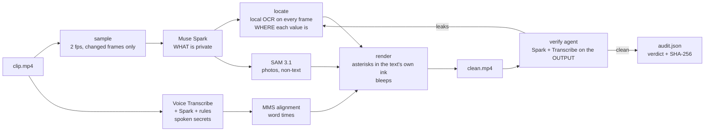

# Parda

**Your recording looks exactly as you made it. Except the secrets.**

Parda ("curtain" in Hindi) is a privacy filter for screen recordings and talking-head clips. It finds private
information on screen and in speech, covers it so the video still reads naturally (a `.env` still looks like a
`.env`, only the values are gone), bleeps spoken secrets to the word, checks its own output with a verify agent,
and writes a receipt.

Built solo for the Meta Global AI Developer Hackathon (Indie track, *Build for Your World*), 27-Oct to 04-Nov-2026.

## Why

I publish screen recordings. One of them showed my tax-ID document for four seconds and I only noticed after it was
live. Checking every frame by hand does not scale, and a regex over OCR misses anything that is not a neat string.
Parda is the step between "stop recording" and "publish".

## What the output looks like

| Before | After |
|---|---|
| `AWS_SECRET_ACCESS_KEY=wJalrXUtnFEMI/K7MDENG/bPxRfiCYEXAMPLEKEY` | `AWS_SECRET_ACCESS_KEY=****************************` |
| A PAN card with a name, a date of birth and a number | The same card; each value is a row of asterisks in the card's own ink |
| A bank statement being scrolled | The same statement scrolling; account number, IFSC, email and amounts stay covered on every frame |
| "My number is nine eight seven six…" | A 1 kHz tone over exactly those words |

Covers are drawn in the text's own colour and size on the text's own background, with no box, tint or label.
Nothing is blurred or pixelated, because both can be reversed; the value's pixels are replaced, never transformed.
A photo on an ID becomes a flat patch.

## Meta models

| Model | What it does in Parda |
|---|---|
| **Muse Spark 1.3** (Meta Model API) | Reads sampled frames and decides *what* is private: ID numbers, names next to IDs, keys, passwords, account numbers, amounts. Also picks spoken secrets out of the transcript, and runs the verify passes over the rendered output |
| **SAM 3.1** (Meta Model API) | Tracks non-text items (the photo on an ID card) through the clip from a box prompt |
| **Muse Voice Transcribe** (Meta Model API) | Transcript of the audio, Hindi and Hinglish included |
| **MMS forced alignment** (Meta open weights, via torchaudio) | Word timings inside a transcript turn, so the bleep covers only the digits |

Real footage always goes to the standard Muse Spark model. The cheaper Contributor tier, where Meta may train on
inputs, is used only for the fake test clips (`PARDA_TEST_DATA=1`).

## How it works



**Spark decides what, OCR decides where.** A vision model's boxes are 10–20 px off, which is a whole line of text,
and an object tracker does not know where a word ends. So the box drawn on a frame comes from OCR on that frame's
own pixels: the line that contains the value, cut down to the value alone using the recogniser's per-character
columns, with both edges snapped to the blank columns between glyphs. Labels and the `=` of `KEY=value` stay.

Full-frame OCR (RapidOCR, CPU, in full-width strips) runs only on keyframes: the first frame, a frame where the
screen changed, every frame of a layout jump such as a zoom or a maximise. Between keyframes each value is carried
while its pixels are unchanged and moved by phase correlation while it scrolls or is dragged, with crop OCR to
confirm. Values first found together move together, so one scrolling in from off-screen is predicted from its
neighbours. A value that cannot be confirmed is dropped after 0.3 s rather than covered by a large guess.

**An LLM finds, rules guarantee the basics, the verify agent checks the output.** One model call is not the same
every time, so an email pattern or a run of five spoken digits is always bleeped whatever Spark says, and the
verify passes look at the rendered video the way a stranger would: fresh Spark passes over its frames and a fresh
transcript of its audio. Anything still readable or audible becomes a new item, is located on the source and
re-rendered, up to three times. `--drop s3` leaves a flag out on purpose to show the loop catching it.

## Use

```bash
python -m venv .venv
.venv/Scripts/pip install -r requirements.txt     # Windows; .venv/bin/pip elsewhere. ffmpeg must be on PATH.
echo META_API_KEY=... > .env
python -m parda redact clip.mp4                   # -> out/clip/clean.mp4 + audit.json
python -m parda find clip.mp4                     # flags only: out/clip/flags.json
python -m parda redact clip.mp4 --verify 0        # skip the verify loop
python -m parda redact clip.mp4 --drop s3 a2      # plant misses, watch verify catch them
```

Output folder: `flags.json` (what Spark found and where it looked), `transcript.json`, `tracks.json` (the exact
box of every value on every frame), `locate_stats.json`, `clean.mp4`, `audit.json` (every item, which pass found
it, each verify pass, the verdict `clean` / `needs review`, SHA-256 of the clean file), `cost.json` (every model
call and its price).

A 2:35 1080p desktop recording costs about $1.50 in Meta API calls including two verify passes.

## Built during the hackathon

Everything in this repository was written during the building period (27-Oct to 04-Nov-2026); the first commit is
inside that window.

- `parda/sample.py`: 2 fps sampling that keeps a frame only if a block of the screen changed.
- `parda/screen.py`: batched Muse Spark flags as JSON (kind, exact text, rough box), merged into one item per secret.
- `parda/speech.py`: Voice Transcribe in ≤10-minute chunks, Spark picks the phrases, deterministic rules back it up
  (Hindi number words and Devanagari digits included), MMS forced alignment for word times.
- `parda/locate.py`: the OCR locator described above.
- `parda/track.py`: SAM 3.1 box-prompt tracking for non-text items, one request per stretch of video.
- `parda/render.py`: asterisk covers in the text's own ink and paper, flat patches for photos, the bleep.
- `parda/verify.py`: the verify-and-fix loop over the rendered output.
- `scripts/make_fake_clip.py`, `scripts/make_props.py`: fake test clips and fake documents (SPECIMEN PAN card,
  bank statement, `.env`) with planted secrets and a `.truth.json`.
- `scripts/score_find.py`: recall against a clip's ground truth. `scripts/style_preview.py`: stills of the covers.

**Baseline, not included:** before the hackathon I used a regex-over-EasyOCR sweep for my own videos. That code is
not in this repo; it is only the baseline Parda is compared against.

## Rules Parda follows

- No blur, no pixelation. Covers are painted from pixels outside the value only.
- No real personal data in demos. Every document in the samples is fake and says so.
- Real footage never goes to a model tier that trains on it.
- Dates in files are ISO; dates for people are `01-Nov-2026`.

## Licence

MIT
